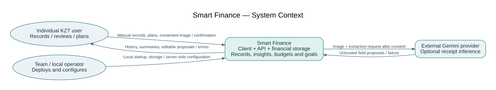
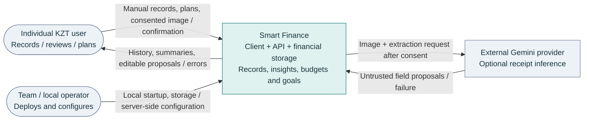

# Smart Finance — System Context

The finance application is one system boundary. External actors are the individual user, the team/local operator and an optional inference provider. There is no bank/payment-system integration. The operator is a deployment role, not an implemented remote admin console. Provider calls do not directly save ledger records. Related requirements: FR01–FR14, NFR01/NFR05.

## Editable Mermaid source

[Download .mmd](system-context.mmd) · [SVG](system-context.svg) · [DOT layout source](system-context.dot)
