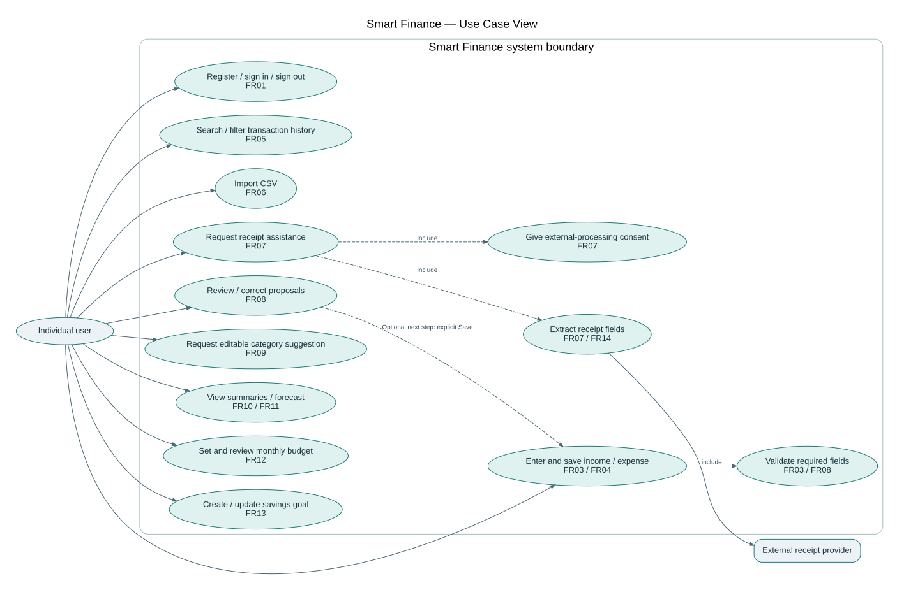
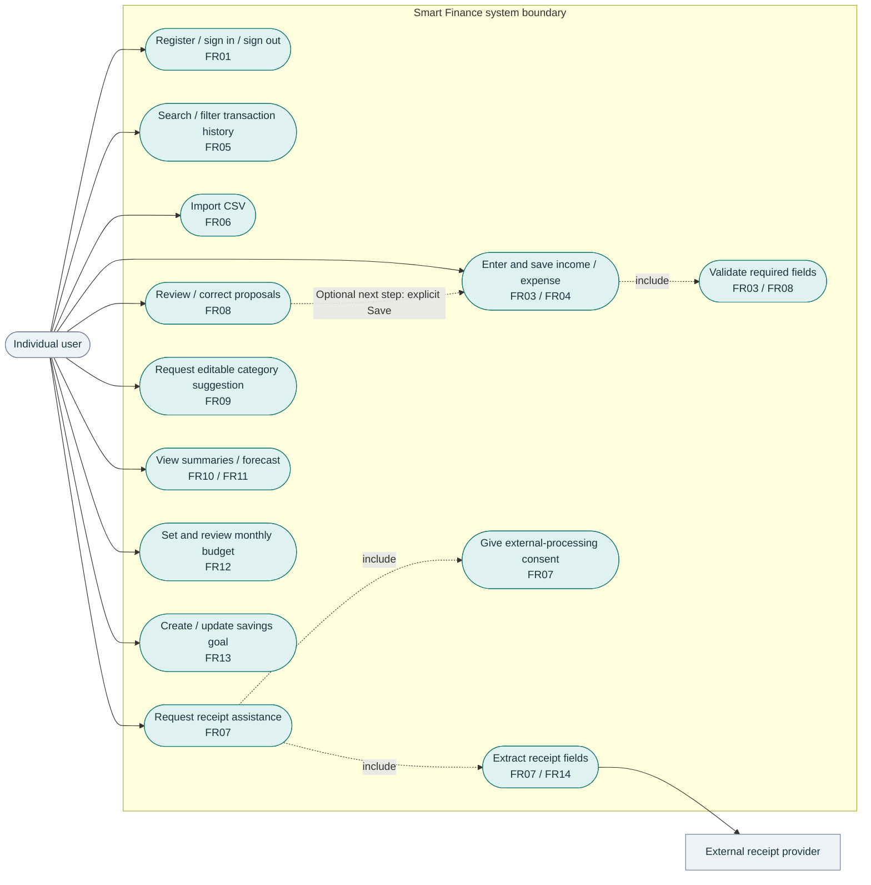

# Smart Finance — Use Case View

A use-case view in Mermaid flowchart notation, with ellipses for user goals and a system boundary. Financial operations require authenticated account access (FR02); authentication is a precondition, not repeated inside every ellipse. Receipt extraction and review do not imply saving: Save is a separate explicit action and invokes validation. A failed/cancelled scan may end in manual entry instead. The diagram does not claim that view-only review writes merchant memory.

## Editable Mermaid source

[Download .mmd](use-case.mmd) · [SVG](use-case.svg) · [DOT layout source](use-case.dot)
